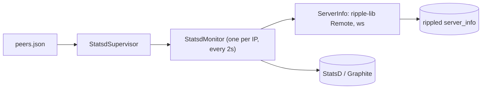

# rippled-server-info-monitor

Polls rippled servers for `server_info` and sends validator health gauges (peers, ledger age and sequence, convergence time, proposers, load) to StatsD/Graphite.

> [!NOTE]
> Dormant since 2015-04-29. Built for Ripple's 2015 test network: `peers.json` lists 2015 server IPs and the default StatsD host is `graphite.rippletest.net`, neither of which is expected to still answer. Dependencies (ripple-lib 0.12, babel-node) are from 2015 and were not run on current Node in this pass. No automated tests.

## What it does

- `ServerInfo` connects to one rippled over WebSocket (ripple-lib `Remote`) and fetches `server_info`.
- `ServerInfoMonitor` calls `fetch()` on an interval and hands the result to `onData(info)`; subclass it to do something with the data.
- `StatsdMonitor` is a subclass that writes six gauges per server.
- `StatsdSupervisor` starts one `StatsdMonitor` per peer and restarts on an uncaught exception.

## How it works



Gauges are written under `server_info.<pubkey_node>.` as `peers`, `age`, `sequence`, `converge_time`, `proposers` and `load_factor`.

`peers.json` groups addresses as `r.ripple.com`, `client_handlers`, `sydney_cluster_1` and `sydney_cluster_2`; `statsd.js` merges the groups and monitors every IP.

## Getting started

Requires `babel-node` for ES6 (not listed in `package.json`; install Babel 5 globally or locally).

```bash
npm install
npm start        # babel-node statsd.js
```

Environment variables (names only): `STATSD_HOST` (default `graphite.rippletest.net`) and `STATSD_PORT` (default `8125`).

The supervisor connects with `ServerInfo(ip, 443, false)`, which is a plain `ws://ip:443` URL.

## Usage

Custom monitor, from the original README:

```js
import ServerInfo from '../lib/server_info'
import Monitor from '../lib/server_info_monitor'

class BasicMonitor extends Monitor {
  onData(data) {
    console.log('GOT THE SERVER INFO', data)
  }
}

let serverInfo = new ServerInfo('52.64.87.184', 51233, false)   // ip, port, secure
new BasicMonitor(serverInfo).start()
```

The default poll interval of `ServerInfoMonitor` is 5000 ms; `StatsdSupervisor` passes 2000 ms. `test/server_info.js` and `test/graphite.js` (`babel-node test/graphite.js <ip> <port> [ssl]`) are manual scripts, not assertions.

## Project history

Created 2015-04-22 as a server info monitor tool; on 2015-04-29 it gained several validator sets, a second Sydney cluster and a `super()` fix, which is the last commit. Uses the author's [promise-while](https://github.com/stevenzeiler/promise-while) package in the dependency list.

## License

ISC, as declared in `package.json`. There is no LICENSE file in the repo.
